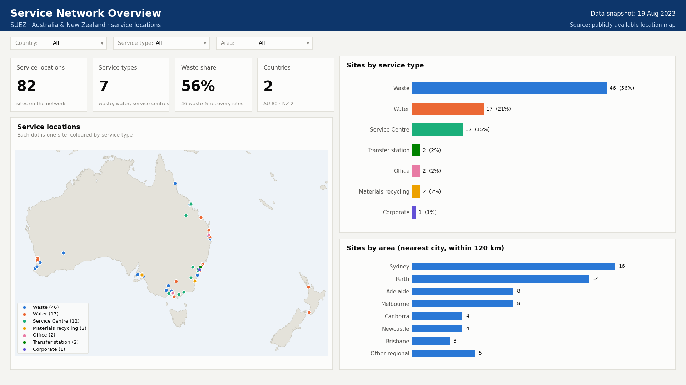
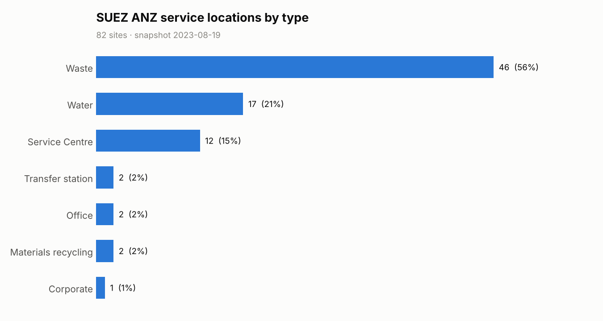
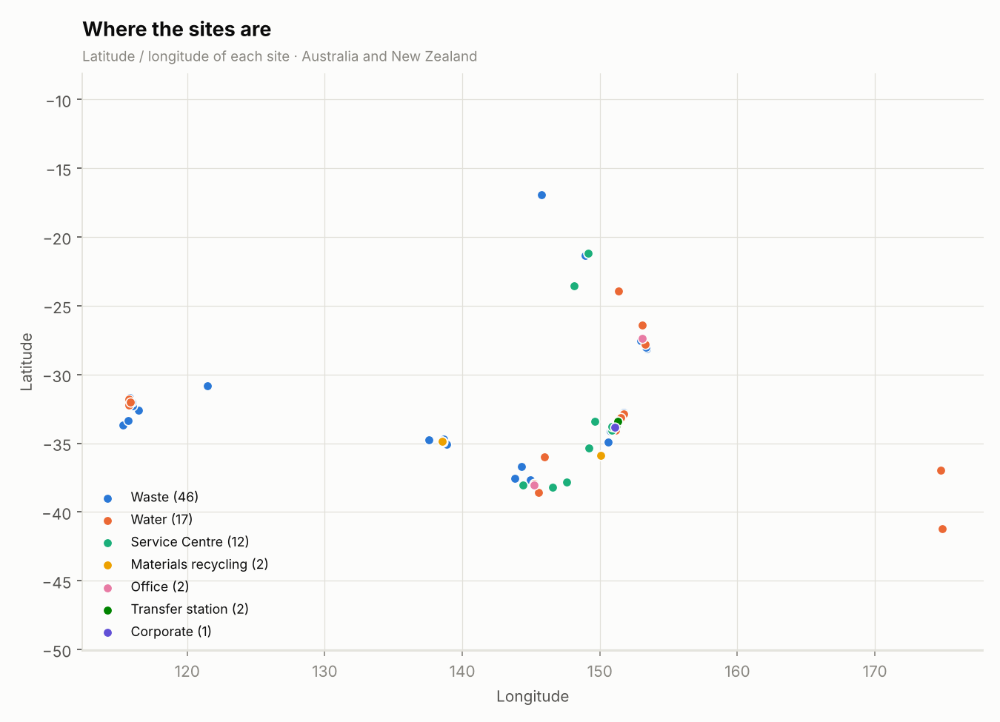
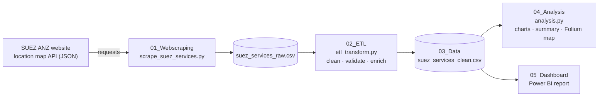

# 🌏 SUEZ Services Dashboard: Australia & New Zealand

**End-to-end data project: web scraping → ETL → exploratory analysis → Power BI dashboard of SUEZ's 82 service locations across Australia and New Zealand.**




> [!IMPORTANT]
> **Data disclaimer:** all data used in this project is **publicly available**. It was collected from the public service-location map on the SUEZ Australia & New Zealand website. No confidential, internal or personal data is used. This is a personal portfolio project and not an official SUEZ product.

---

## 📌 Overview

SUEZ helps businesses, governments and communities in Australia and New Zealand protect, access and optimise natural resources, and create new resources by reusing and recycling water and waste.

This project collects **every SUEZ service location** published on the company's public location map, cleans and enriches the data, analyses it with Python, and presents it in an **interactive Power BI dashboard** with a map, slicers and cross-filtering.

**Skills demonstrated:** API-based web scraping · data cleaning & validation · geospatial enrichment · exploratory data analysis · data visualisation · Power BI report design.

## 🔎 Key insights

*Snapshot of 19 August 2023: 82 sites, 7 service types.*



- **Waste is the core network:** 46 sites, **56 %** of all locations, including 21 resource-recovery and recycling facilities, transfer stations and landfills.
- **Water** is the second activity with **17 sites (21 %)**, and the only service present in **New Zealand** (2 sites).
- **12 Service Centres (15 %)** support field operations across the major metropolitan areas.
- **97.6 % of sites are in Australia** (80 of 82). The largest clusters are **Sydney (16 sites)** and **Perth (14)**, followed by **Adelaide** and **Melbourne** (8 each). South-east Queensland (Brisbane, Gold Coast, Sunshine Coast) adds 7 more.
- **Regional sites** in Queensland (Cairns, Mackay area, Emerald) and Western Australia (Kalgoorlie) are mainly **waste and resource-recovery** facilities with their supporting service centres.



## 🖥️ Power BI dashboard

The report combines a **map of every site**, **KPI cards**, a **service-type breakdown** and an **area view**, with slicers for country, service type and area and full cross-filtering. Rebuild steps are in [05_Dashboard/README.md](05_Dashboard/README.md).


## 🏗️ Architecture



| Step | Script | What it does |
|---|---|---|
| **1. Scrape** | `01_Webscraping/scrape_suez_services.py` | Calls the JSON endpoint behind SUEZ's location map, extracts locations (`PoiItem`) and service types (`MapIcon`), joins them and stamps the extraction time |
| **2. Transform** | `02_ETL/etl_transform.py` | Trims text, validates coordinates, removes duplicate sites, adds a **country** column, enforces data checks, writes the clean dataset |
| **3. Analyse** | `04_Analysis/analysis.py` | Prints key figures, saves charts to `docs/images/`, a summary table and an interactive **Folium** map |
| **4. Visualise** | `05_Dashboard/` | Power BI report with map, slicers, KPI cards and cross-filtering ([details](05_Dashboard/README.md)) |

<details>
<summary>Original architecture diagram</summary>


</details>

## 📊 Data dictionary

`03_Data/suez_services_clean.csv`: one row per service location.

| Column | Type | Description |
|---|---|---|
| `service_name` | text | Site name, e.g. *Eastern Creek Organic Resource Recovery Facility* |
| `service_type` | text | Waste, Water, Service Centre, Materials recycling, Transfer station, Office, Corporate |
| `country` | text | Australia / New Zealand (derived from coordinates) |
| `latitude`, `longitude` | decimal | WGS84 coordinates (6 decimals) |
| `service_icon` | URL | Map icon used on the SUEZ website |
| `last_updated_at_UTC` | datetime | When the data was extracted |

## 🚀 Getting started

```bash
git clone https://github.com/Mayur96k/suez-services-powerbi-dashboard.git
cd suez-services-powerbi-dashboard
pip install -r requirements.txt

python 01_Webscraping/scrape_suez_services.py   # optional: refresh the raw data from the website
python 02_ETL/etl_transform.py                  # raw → clean dataset
python 04_Analysis/analysis.py                  # charts, summary, interactive map
```

The repository already includes the 2023 snapshot, so steps 2 and 3 work without scraping. Open `04_Analysis/outputs/service_map.html` in a browser for the interactive map, and see [05_Dashboard/README.md](05_Dashboard/README.md) to rebuild the Power BI report.

## 📁 Project structure

```
suez-services-powerbi-dashboard/
├── 01_Webscraping/
│   ├── scrape_suez_services.py   # API scraper
│   └── suez_services_raw.csv     # raw snapshot (19 Aug 2023)
├── 02_ETL/
│   └── etl_transform.py          # cleaning, validation, enrichment
├── 03_Data/
│   └── suez_services_clean.csv   # analysis-ready dataset
├── 04_Analysis/
│   ├── analysis.py               # EDA, charts, Folium map
│   └── outputs/summary.csv       # sites by type and country
├── 05_Dashboard/
│   └── README.md                 # Power BI report: contents and rebuild steps
├── docs/images/                  # dashboard overview and charts used in this README
└── requirements.txt
```

## 🧰 Tech stack

**Python** (requests, pandas, matplotlib, Folium) · **Power BI Desktop** · **VS Code / Jupyter**

## ⚠️ Notes & limitations

- All data comes from SUEZ's **public** website location map; no internal or personal data is used. It is a **point-in-time snapshot** (19 Aug 2023) and the site list may have changed since.
- The website endpoint is undocumented and may change; the scraper fails clearly (HTTP error) if it does.
- `country` is derived from coordinate ranges; a state/region column would need reverse geocoding (see roadmap).
- This is a personal portfolio project and not an official SUEZ product.

## 🗺️ Roadmap

- [ ] Commit the `.pbix` report
- [ ] Add state/region via reverse geocoding (e.g. NSW, VIC, QLD) for regional analysis
- [ ] Schedule the scraper (GitHub Actions) to track how the network changes over time
- [ ] Population and distance-to-site analysis to show service coverage

## 👤 Author

**Mayur Jagtap**: Data & BI Engineer
[GitHub](https://github.com/Mayur96k) · mayurjagtap96k@gmail.com

Found a bug or have an idea? Please [open an issue](https://github.com/Mayur96k/suez-services-powerbi-dashboard/issues).

## 📄 License

© 2023 Mayur Jagtap. All rights reserved.
